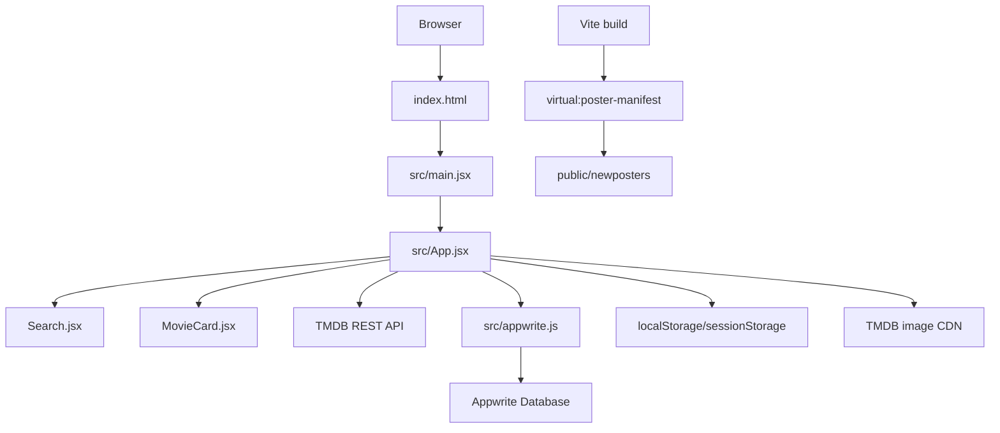
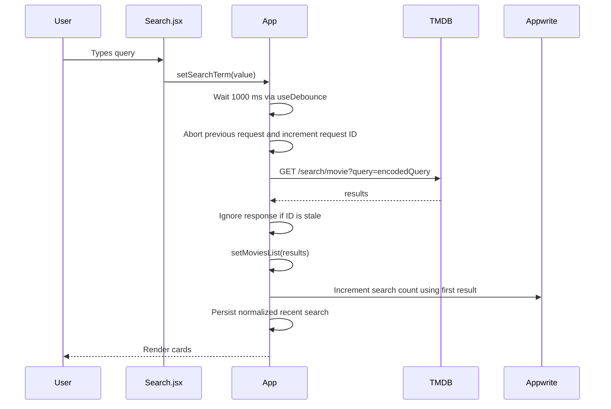

# FilmPoint / MovieVerse: Project Interview Guide

This document is the source-of-truth briefing for understanding, explaining, reviewing, and interviewing on this repository. It is written from the implementation currently in the repository, not from assumptions about a future architecture.

## 1. Executive Summary

This is a client-side React movie discovery application built with Vite. Users can:

- Browse popular movies from TMDB.
- Search TMDB movies as they type, with a one-second debounce.
- View trending search terms recorded in Appwrite.
- Save movies to a local watchlist.
- Optionally synchronize that watchlist to an Appwrite collection using a device-specific key.
- Open movie details in a modal, loading richer details on demand.
- Sort the local watchlist by recent, title, or rating.
- Use recent searches and a weighted personalized random search.

There is no application server in this repository. The browser calls TMDB and Appwrite directly. Vite injects `VITE_*` environment variables into the browser bundle at build time. Vercel serves the generated static site and provides cache headers for static assets.

The central orchestration component is `src/App.jsx`. `src/components` contains focused UI components, `src/api/tmdb.js` owns the TMDB request headers, and `src/appwrite.js` owns Appwrite persistence operations.

## 2. AI Context Brief

Use the following facts when answering questions about this project:

- Product: movie discovery and personal watchlist web app.
- Runtime: browser-rendered React 19 application.
- Build tool: Vite, using the `rolldown-vite` package override.
- Styling: Tailwind CSS v4 through the Vite plugin plus custom CSS in `src/index.css`.
- Primary data provider: TMDB REST API v3.
- Optional backend services: Appwrite Database for trending search analytics and watchlist synchronization.
- Local persistence: `localStorage` for the watchlist, recent searches, device key, and pending sync queue; `sessionStorage` for random-pick history.
- Deployment: Vercel static deployment.
- Authentication: none. The device key is an anonymous client-generated identifier, not user authentication.
- State ownership: almost all application state is local to `App` with React hooks.
- Main consistency strategy: local-first watchlist updates followed by best-effort background synchronization.
- Search strategy: controlled input -> one-second debounce -> abort previous request -> TMDB search/discover request.
- Stale request protection: both `AbortController` and monotonically increasing request IDs are used.
- External failure behavior: search errors are shown with a retry action; Appwrite failures generally degrade to local-only behavior.
- Verified status on 2026-09-12: `npm run lint` passes and `npm run build` passes.

## 3. Repository Map

| Path | Responsibility |
| --- | --- |
| `index.html` | HTML shell, Google Analytics bootstrap, favicon, root mount node, viewport metadata. |
| `src/main.jsx` | React entry point; imports global CSS; mounts `App` under `StrictMode`, `HelmetProvider`, and Vercel Speed Insights. |
| `src/App.jsx` | Main state machine, API orchestration, persistence, rendering, modal, watchlist, trending UI, and page composition. |
| `src/api/tmdb.js` | Shared TMDB `fetch` options and bearer authorization header. |
| `src/appwrite.js` | Conditional Appwrite client setup and database CRUD helpers. |
| `src/components/Search.jsx` | Controlled search form, clear button, random pick, recent-search controls. |
| `src/components/MovieCard.jsx` | Movie card presentation, poster fallback, image accent extraction, save/watch/download actions. |
| `src/components/MovieCardSkeleton.jsx` | Loading placeholder card. |
| `src/components/Spin.jsx` | Flowbite loading spinner used by the detail modal. |
| `src/index.css` | Tailwind imports, theme, layout, responsive styling, animation, modal, watchlist, and card styles. |
| `src/App.css` | Older standalone movie action styles; currently not imported by `main.jsx`. |
| `vite.config.js` | React, Tailwind, Flowbite plugins and the custom virtual poster-manifest plugin. |
| `eslint.config.js` | Flat ESLint configuration for JavaScript/JSX and React hooks/refresh rules. |
| `package.json` | Scripts and runtime/build dependencies. |
| `public/newposters/` | Local landing-page poster assets discovered at build time. |
| `public/hero-bg.png`, `hero.png`, `no-movie.png`, `search.svg`, `star.svg` | Static visual and fallback assets. |
| `vercel.json` | Cache headers for poster files and hashed build assets. |
| `.env` | Local secrets/configuration; ignored by Git and must never be committed. |
| `dist/` | Generated production output; do not edit manually. |

## 4. Runtime Architecture



### Architectural style

The application is a modular monolith at the frontend level: one page, one main orchestration component, a few presentational components, and service modules for external systems. It is not a layered backend system and does not have a repository/domain/service architecture. This is appropriate for a small single-page project, but `App.jsx` is now large enough that extracting hooks and domain utilities would improve maintainability.

### Rendering model

- `createRoot` mounts a client-rendered React tree.
- `StrictMode` can intentionally invoke development lifecycle paths more than once; effects must therefore be idempotent.
- `HelmetProvider` allows `App` to set document title and social metadata.
- Vercel Analytics and Speed Insights are client integrations.
- The initial page is rendered with local poster assets, then TMDB/Appwrite data is fetched asynchronously.

## 5. Main User Flows

### Initial load

1. `main.jsx` mounts `App`.
2. Module initialization reads the generated poster manifest and prepares two shuffled poster rows.
3. `App` initializes empty/default state.
4. An effect loads the normalized watchlist from `localStorage`.
5. If watchlist sync is configured, hydration and queued-mutation flushing start.
6. Another effect loads recent searches from `localStorage`.
7. The debounced search term starts empty, so the app calls TMDB `discover/movie?sort_by=popularity.desc`.
8. A separate effect calls Appwrite for the top trending search documents.

### Search flow



Important behavior:

- The input is controlled by `searchTerm`.
- `debouncedSearchTerm` is separate, so the UI can show a pending state while waiting.
- Whitespace is normalized and empty input returns to popular discovery results.
- The query is URL encoded.
- A failed request shows an error state and retry button.
- Search analytics failure does not replace successful movie results.

### Movie details flow

1. Clicking a movie-card poster opens the modal immediately.
2. If enough detail fields already exist, no second TMDB request is made.
3. Otherwise, `GET /movie/{id}` loads runtime, genres, backdrop, and synopsis data.
4. The previous detail request is aborted before starting a new one.
5. A request ID prevents an old response from overwriting a newer selection.
6. Escape and backdrop click close the modal; body scrolling is disabled while it is open.

### Watchlist flow

The watchlist is local-first:

1. A movie is normalized to a small stable shape.
2. Duplicate IDs are removed through a `Map`.
3. React state updates immediately, so the UI feels instant.
4. An effect writes the normalized list to `localStorage`.
5. If Appwrite sync is configured, an `add` or `remove` mutation is appended to a local queue.
6. The queue is flushed immediately when possible and retried on the browser `online` event.
7. On a later load, remote documents are fetched and merged into local state.

Current conflict rule: remote items are loaded first, then local items overwrite matching IDs. Local state therefore wins for same-ID conflicts during merge. There are no user accounts or server-side timestamps used for conflict resolution.

### Trending flow

Appwrite stores one document per search term with a count and the first result's movie/poster information. `getTrendingSearches` orders by descending count and limits the result to ten. Clicking a trending item fetches the TMDB movie detail to obtain an IMDb ID, then navigates a newly opened tab to IMDb.

### Random search flow

Candidate titles are weighted from three sources:

- Watchlist titles: weight 6.
- The first twenty current results: weight 3.
- A hard-coded fallback list: weight 1.

Recent searches and the current query are excluded. A session history prevents repeats until the candidate pool is exhausted. Selection is weighted using a random cursor.

## 6. Data Contracts

### TMDB movie shape used by the UI

The UI reads fields such as `id`, `title`, `poster_path`, `backdrop_path`, `overview`, `release_date`, `vote_average`, `original_language`, `genre_ids`, `genres`, `runtime`, `popularity`, and `imdb_id`. Search results usually contain the list-oriented fields; the detail endpoint supplies richer fields.

### Normalized local watchlist entry

```js
{
  id: Number,
  title: String,
  poster_path: String,
  release_date: String,
  vote_average: Number | null,
  overview: String,
  addedAt: ISOString
}
```

The normalizer accepts either `id` or `movie_id`, rejects invalid IDs, supplies defaults, and deduplicates by numeric movie ID.

### Appwrite search document

Expected attributes:

```text
searchTerm: string
count: integer
movie_id: integer
poster_url: string
```

### Appwrite watchlist document

Expected attributes from the README:

```text
device_key: string, required
movie_id: integer, required
payload: string, required
updated_at: string, required
```

The full movie object is serialized into `payload`. This is simple and flexible, but it is less queryable and less type-safe than storing individual movie attributes.

### Local storage keys

| Key | Contents |
| --- | --- |
| `movie-watchlist` | Normalized local movie array. |
| `movie-watchlist-device-key` | Anonymous browser/device identifier. |
| `movie-watchlist-sync-queue` | Ordered pending `add`/`remove` mutations. |
| `movie-recent-searches` | Up to eight normalized recent searches. |
| `movie-random-pick-history` | Session-scoped lower-case selected titles. |

## 7. External Services and Configuration

### TMDB

`src/api/tmdb.js` reads `VITE_API_KEY` and creates shared GET headers with `Authorization: Bearer ...`. `App.jsx` uses the shared options for search, discovery, details, and trending-to-IMDb lookup. Poster URLs are converted from TMDB paths to `https://image.tmdb.org/t/p/w500...`.

### Appwrite

The Appwrite client is created only when enough environment variables exist. Search tracking requires project, database, collection, and endpoint. Watchlist synchronization requires project, database, watchlist collection, and endpoint. If configuration is incomplete, helper methods return safely or return empty data, allowing local-only operation.

### Vite environment security

Any `VITE_*` variable is exposed to client-side JavaScript. The TMDB bearer token is therefore not a server secret in this architecture. A production-grade design would proxy TMDB calls through a server or edge function, keep the TMDB credential server-side, add rate limiting, and validate requests there. The local `.env` contains a token-like credential and must remain ignored; if it has ever been committed or exposed, rotate it.

### Vercel

`vercel.json` gives poster files one-day caching with stale-while-revalidate and hashed `/assets` files one-year immutable caching. Vite's hashed asset names make the long cache safe for generated JS/CSS. No SPA rewrite is configured because the current app is a single root page without client-side routes.

## 8. Build-Time Poster Manifest

The custom plugin in `vite.config.js` registers `virtual:poster-manifest`. During module loading it reads `public/newposters`, filters image extensions, sorts filenames, and returns generated JavaScript such as `export default ["poster-a.jpg", ...]`. `App.jsx` imports this virtual module and builds the landing gallery from it.

When a poster is added or removed during development, `handleHotUpdate` sends a full reload. This avoids maintaining a manually edited asset index.

## 9. State and Effect Inventory

| State/ref | Purpose |
| --- | --- |
| `searchTerm` | Immediate controlled input value. |
| `debouncedSearchTerm` | Query that is allowed to trigger TMDB. |
| `moviesList` | Current discovery/search result list. |
| `trendingMovies` | Appwrite trending search documents. |
| `isLoading`, `errorMessage` | Search/discovery request status. |
| `selectedMovie`, `isDetailOpen` | Detail modal selection and visibility. |
| `detailLoading`, `detailError` | Detail request status. |
| `watchlist`, `isWatchlistHydrated` | Local-first saved movies and persistence guard. |
| `recentSearches` | Local search history. |
| `watchlistSort` | Current list sorting mode. |
| `watchlistToast` | Short-lived feedback message. |
| `detailRequestIdRef` | Stale detail-response guard. |
| `moviesRequestIdRef` | Stale search-response guard. |
| Abort controller refs | Cancel in-flight TMDB requests. |
| `randomPickHistoryRef` | Avoid repeated random choices in a session. |
| `isFlushingSyncQueueRef` | Prevent concurrent sync queue flushes. |

## 10. Performance Decisions

- Debouncing reduces TMDB calls while typing.
- Abort controllers cancel obsolete network work.
- Request IDs protect against races even if cancellation is too late.
- Lazy image loading is used for cards and most gallery images.
- `decoding="async"` avoids blocking layout on image decode.
- Skeleton cards preserve the grid shape during loading.
- `content-visibility: auto` is used on the movie library section.
- Vercel cache headers optimize static assets.
- The gallery duplicates its list to create a continuous animation.
- `prefers-reduced-motion` pauses poster movement.

Potential performance improvements: virtualize very large result lists, request only needed TMDB fields where supported, avoid logging in production, cache repeated TMDB responses, and move poster color extraction off the main thread if it becomes expensive.

## 11. Accessibility and UX Notes

Existing positive patterns:

- Search has `role="search"` and an accessible label.
- Loading/status text uses `aria-live`.
- Save buttons expose `aria-label` and `aria-pressed`.
- The detail panel uses dialog semantics and an accessible title/description.
- Escape closes the modal.
- Watchlist items support keyboard Enter/Space activation.
- Images have meaningful alt text or are explicitly decorative.
- Reduced-motion preference is respected for the marquee.

Gaps worth discussing in an interview:

- Modal focus is not trapped or restored to the triggering element.
- Some clickable trending items are `li` elements with mouse behavior rather than keyboard-native buttons.
- The watchlist item is a `div`-like list item with role emulation instead of a button.
- The newly opened trending tab can remain blank if TMDB returns no IMDb ID.
- The `Watch` action points to third-party streaming domains; this creates trust, legal, availability, and security concerns and should be reviewed before production.

## 12. Testing Strategy

Current repository validation consists of:

```text
npm run lint
npm run build
```

There are no unit, integration, end-to-end, or component tests in the repository. A useful testing plan would include:

1. Pure utility tests for normalization, poster URL fallback, deduplication, queue parsing, merge behavior, and weighted candidate exclusion.
2. Component tests for Search, MovieCard, loading/error states, modal close behavior, and watchlist toggle behavior.
3. Mocked API tests for aborts, stale responses, non-2xx responses, empty search results, and Appwrite failure degradation.
4. Browser tests for initial load, typing search, retry, localStorage persistence, offline queueing, online flush, keyboard modal use, and responsive layouts.
5. Accessibility checks for focus order, dialog focus management, labels, contrast, and reduced motion.

## 13. Known Risks and Bugs to Be Ready to Explain

### High priority

- **Client-exposed TMDB credential:** `VITE_API_KEY` is bundled into the browser. Treat it as public and rotate any exposed credential. Use a server-side proxy for real secrecy and rate limiting.
- **Third-party watch/download links:** Movie cards construct links to external streaming/download domains. This is a major trust, compliance, and availability risk and should not be presented as an unreviewed production feature.
- **Anonymous device identity:** The generated device key is not authentication. Anyone who obtains it may be able to access that device's Appwrite watchlist, depending on collection permissions.

### Medium priority

- **Race in search analytics:** Search results are committed before awaiting `updateSearchCount`, which is good for UX, but repeated searches can create concurrent count updates and lost increments in Appwrite's read-then-write pattern.
- **Race in watchlist upsert:** `listDocuments` followed by create/update is not atomic. Two tabs can create duplicate documents unless a unique index or server-side transaction enforces uniqueness.
- **Queue growth:** Every add/remove is appended. Repeated toggles can create redundant operations. Coalescing by movie ID would reduce work.
- **Remote deletion semantics:** An empty remote response does not clear local data. This is intentional local-first behavior but means server deletions do not propagate.
- **Payload schema drift:** JSON movie payloads can become incompatible as TMDB fields or normalization rules change.
- **Image URL trust:** Remote image URLs are placed into CSS background images and `img` sources. The current values mostly originate from TMDB, but a future user-controlled source would need validation.

### Lower priority / maintainability

- `App.jsx` contains API orchestration, storage, synchronization, UI, and domain transformations; custom hooks would reduce coupling.
- Poster URL normalization is duplicated in `App.jsx`, `MovieCard.jsx`, and `appwrite.js`.
- `App.css` appears to contain obsolete styles not imported by the entry point.
- README branding and clone path differ from the current `FilmPoint`/`MovieVerse` text and repository path.
- `VITE_APPWRITE_PROJECT_NAME` is documented/read from `.env` but not used by `appwrite.js`.
- `Spin.jsx` depends on Flowbite for a small loading UI while most styling is custom/Tailwind; dependency usage could be simplified.
- `loadTrendingMovies` is an async function called in an effect without cancellation, although its result is small and failure is non-fatal.

## 14. Recommended Improvement Roadmap

### First pass: security and correctness

1. Rotate the currently local TMDB token if it has ever been exposed.
2. Move TMDB requests behind a Vercel serverless/edge function.
3. Remove or replace unreviewed third-party watch/download links.
4. Configure Appwrite permissions deliberately and replace the device key with authenticated users if cross-device privacy matters.
5. Add unique indexing or a server-side upsert function for `(device_key, movie_id)`.

### Second pass: structure and testability

1. Extract `useMovieSearch`, `useWatchlist`, `useMovieDetails`, and `useRecentSearches` hooks.
2. Move pure storage/normalization/queue functions into tested utility modules.
3. Create one shared poster URL helper.
4. Add API client modules for TMDB and Appwrite with typed response boundaries.
5. Add tests for pure functions first, then component and browser tests.

### Third pass: product quality

1. Add pagination or infinite scroll with an explicit result limit.
2. Add caching and stale-while-revalidate behavior for repeated searches.
3. Improve modal focus trapping and restore focus after close.
4. Add keyboard-native buttons for trending items and watchlist cards.
5. Add observability for API latency, error rates, and sync failures without logging sensitive values.

## 15. Interview Questions and Model Answers

### Architecture

**Q: Why use Vite and React here?**  
**A:** Vite provides fast development feedback and a small static production build, while React provides component rendering and hook-based state management. The application is a single-page client experience, so a client-rendered Vite app is a reasonable fit.

**Q: Is this a three-tier architecture?**  
**A:** Not strictly. It is a browser client that directly calls two external services. There is no custom backend tier. Appwrite is an external persistence service, not code in this repository.

**Q: What is the main architectural weakness?**  
**A:** `App.jsx` is the orchestration boundary for too many concerns. It works for the current scope, but custom hooks and service modules would make state transitions, testing, and future features easier.

### React and state

**Q: Why keep both raw and debounced search terms?**  
**A:** The raw value keeps the input responsive. The debounced value controls network traffic. Comparing them lets the UI communicate that a request is pending.

**Q: How does the app avoid stale search results?**  
**A:** Before each request it aborts the previous controller and increments a request ID. A response updates state only if its ID is still current. The ID check is important because aborting is cooperative and a response may already be resolving.

**Q: Why does the watchlist save effect have a hydration guard?**  
**A:** Without `isWatchlistHydrated`, the initial empty React state could be written to storage before the existing stored list is read, destroying user data. The guard ensures persistence starts after initialization.

**Q: Why use refs instead of state for request IDs and controllers?**  
**A:** They are mutable coordination values that should persist between renders but do not themselves need to trigger a render.

**Q: What does StrictMode change?**  
**A:** In development React may re-run certain lifecycle paths to expose unsafe side effects. Effects and external calls should tolerate repeated setup/cleanup. Production behavior does not include the same development double-invocation pattern.

### APIs and data

**Q: How does an empty query differ from a search query?**  
**A:** Empty input calls TMDB discover sorted by popularity; a non-empty normalized input calls the movie search endpoint with an encoded query.

**Q: Why is `response.ok` checked?**  
**A:** `fetch` resolves for HTTP error statuses. Checking `ok` converts non-2xx responses into the same application error path as network failures.

**Q: How is optional Appwrite configured?**  
**A:** Module-level booleans check whether required environment variables exist. The client is created only when a valid search-tracking or watchlist-sync configuration is present. Missing configuration causes safe no-op or empty-return behavior.

**Q: Why use a local sync queue?**  
**A:** It preserves user intent when Appwrite is unavailable or the browser is offline. Local UI state is immediate, and the ordered mutations can be retried later.

**Q: What consistency model does the watchlist have?**  
**A:** Local-first, eventually synchronized, best-effort consistency. It is not strongly consistent and has no authenticated multi-device conflict protocol.

### Security

**Q: Is `VITE_API_KEY` secret?**  
**A:** No. Vite statically exposes `VITE_*` variables to the client bundle. A bearer token in that variable can be extracted by anyone using the site. It should be restricted/rotated and ideally kept behind a server proxy.

**Q: Is the device key authentication?**  
**A:** No. It is an identifier, not proof of identity. It provides continuity for one browser but not confidentiality or account security.

**Q: What risks come from `window.open`?**  
**A:** The app uses `noopener,noreferrer` for card links, which helps isolate the opener. Trending navigation first opens a blank tab and later changes its location; it should also guard against a blocked/null popup and validate the destination.

### Performance and UX

**Q: What optimizations are already present?**  
**A:** Debouncing, cancellation, stale-response guards, lazy images, async decoding, skeletons, content visibility, static caching, and reduced-motion handling.

**Q: Why use skeletons?**  
**A:** They preserve the expected grid shape and communicate progress without shifting the page as much as a blank loading state.

**Q: What would you measure in production?**  
**A:** Search latency, TMDB error rate, Appwrite sync success/failure, queue length, modal detail latency, image failure rate, Core Web Vitals, and conversion from search to saved movie.

### Testing

**Q: What is missing from the current test strategy?**  
**A:** There are no automated tests beyond lint/build. The highest-value first tests cover pure normalizers and queue logic, then mocked request races and local persistence behavior.

**Q: How would you test request cancellation?**  
**A:** Mock two requests, resolve the older one after the newer one, and assert that only the newer result remains in `moviesList`. Also assert that the old signal was aborted.

**Q: How would you test offline synchronization?**  
**A:** Mock Appwrite failure, toggle a movie, assert local state and queue persistence, dispatch an `online` event after restoring the mock, and assert queued operations are sent and removed only after success.

## 16. Practical Commands

Run from the directory containing `package.json`:

```bash
npm install
npm run dev
npm run lint
npm run build
npm run preview
```

The default development URL is `http://localhost:5173`.

## 17. Interview Opening Statement

“This is a Vite-powered React movie discovery SPA. The browser queries TMDB for popular and searched movies, while Appwrite optionally records trending searches and synchronizes a watchlist. The watchlist is local-first: it normalizes and persists immediately in localStorage, queues remote mutations for retry, and merges remote data on startup. Search is controlled and debounced, and request IDs plus AbortController prevent stale responses. The main tradeoff is simplicity versus security: direct browser-to-TMDB access keeps the app small, but exposes the bearer token and provides no server-side rate limiting or authenticated user boundary.”
